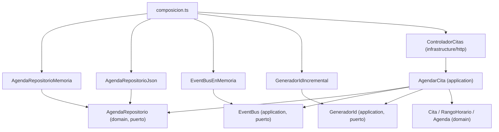

# Pull Request — Laboratorio SaludYa (Arquitectura Hexagonal)

## 1. Información del proyecto

- **Proyecto:** SaludYa — agenda de citas (red de clínicas)
- **Laboratorio:** Arquitectura hexagonal (Módulo 1, sesión 3)
- **Repositorio:** https://github.com/Heiner09/saludya-arquitectura-hexagonal
- **Rama de entrega:** `entrega-saludya`
- **Rama base:** `main`
- **Commit base:** `9b37748 feat(saludya): registra implementacion inicial del laboratorio hexagonal`

No se registran integrantes ni docentes en este documento porque no están disponibles en el repositorio.

## 2. Objetivo y alcance

### Funcionalidades implementadas

- Agendar una cita validando el rango horario y evitando cruces con citas activas del mismo médico.
- Cancelar una cita existente y marcarla como cancelada.
- Persistencia en memoria (`AgendaRepositorioMemoria`) y en archivo JSON (`AgendaRepositorioJson`).
- Bus de eventos en memoria (`EventBusEnMemoria`) con eventos `"cita.confirmada"` y `"cita.cancelada"`.
- Generador de identificadores incremental (`GeneradorIdIncremental`).
- Adaptador HTTP mínimo (`ControladorCitas`) para agendar, con traducción de errores de dominio a estados HTTP.
- Composición centralizada en `src/composicion.ts` (`crearApp({ tipo: "memoria" | "json" })`).

### Limitaciones verificadas

- `ControladorCitas` solo expone la operación de agendar; no hay endpoint de cancelación en el controlador.
- `crearApp` instancia `AgendarCita`, pero no instancia ni expone `CancelarCita` en la aplicación compuesta.
- No hay servidor HTTP real ni base de datos real; todo es en memoria o archivo JSON.
- No hay manejo de concurrencia ni escritura atómica en el adaptador JSON.
- No existen archivos `agendas*.json` generados actualmente.

## 3. Arquitectura

Dependencias verificadas por imports:

- `src/domain/`: no importa de fuera de `src/domain/`.
- `src/application/`: importa solo de `domain/` y `application/`.
- `src/infrastructure/`: implementa puertos; no importa entre adaptadores de distintas carpetas.
- `src/composicion.ts`: único lugar que decide adaptadores concretos.

Puertos:

- `AgendaRepositorio` (`src/domain/agenda-repositorio.ts`): `porMedico`, `guardar`.
- `EventBus` (`src/application/puertos.ts`): `emit`.
- `GeneradorId` (`src/application/puertos.ts`): `nuevo`.

Diagrama de dependencias basado en los componentes actuales:



## 4. Decisiones arquitectónicas

Decisiones verificables en el código actual:

1. **Regla de dependencia hacia adentro** (`infrastructure → application → domain`), respaldada por los imports de `src/`.
2. **Dominio puro**: `src/domain/` no importa `node:*` ni librerías externas.
3. **Puertos como interfaces**: `AgendaRepositorio`, `EventBus`, `GeneradorId`.
4. **Composición única**: solo `src/composicion.ts` instancia adaptadores concretos.
5. **Glosario del equipo** registrado en `docs/GLOSARIO.md`.
6. **Dos reglas propias** añadidas en `AGENTS.md` (protección de arquitectura y verificación antes de avanzar).

Alternativas descartadas o decisiones históricas (respaldadas por la conversación del laboratorio; no por commits históricos, ya que el repositorio solo contiene el commit inicial `9b37748`):

- Implementación por etapas y archivo por archivo, para facilitar el aprendizaje y aislar errores.
- Persistencia JSON mediante un único archivo con arreglo de agendas, frente a un archivo por médico o a una base de datos real.
- Uso de puertos e interfaces para permitir adaptadores intercambiables.

Nota: estas decisiones se respaldan por la conversación del laboratorio, no por historial Git. Las decisiones verificables directamente en el código se listan arriba.

## 5. Evidencia de pruebas

Resultados reportados de las ejecuciones realizadas en OpenCode (no se inventan capturas ni fechas):

- `npm test`: **34 aprobadas, 0 fallidas** (9 archivos de test).
- `npm run typecheck`: **sin errores** (código de salida 0).
- `npm run test:arquitectura`: **5 aprobadas, 0 fallidas** (1 archivo).

Estado de Git al verificar evidencias: rama `entrega-saludya`, árbol de trabajo limpio (`## entrega-saludya`).

## 6. Comentarios de revisión (propuestos, no publicados en GitHub)

### A. `src/domain/agenda.ts` — copia superficial
- **Líneas:** 11 y 34
- **Fragmento:**
  ```ts
  this.citasInternas = [...citas];
  ...
  return [...this.citasInternas];
  ```
- **Observación:** la copia es superficial: protege el arreglo (no se pueden añadir/quitar elementos desde fuera), pero los objetos `Cita` siguen compartiendo referencia. Como `Cita` tiene estado mutable (`cancelar()`, líneas 8 y 41–45 de `src/domain/cita.ts`), es posible modificar el estado de una cita obtenida externamente.
- **Tipo:** riesgo verificable (no se ha demostrado un fallo; es una limitación de encapsulamiento).

### B. `src/application/agendar-cita.ts` — import no utilizado
- **Línea:** 4
- **Fragmento:**
  ```ts
  import { RangoInvalidoError, CruceDeHorarioError } from "../domain/errores";
  ```
- **Observación:** `RangoInvalidoError` se importa pero no se utiliza en el archivo (búsqueda confirmó una única referencia, la del import). `RangoHorario.crear` es quien lanza el error.
- **Tipo:** mejora opcional (no afecta comportamiento ni pruebas).

### C. `src/infrastructure/persistence/agenda-repositorio-json.ts` — manejo de JSON y concurrencia
- **Líneas:** 29, 30–34, 39 y 65–84
- **Fragmento:**
  ```ts
  return JSON.parse(texto) as AgendaJson[];
  ...
  } catch (error) {
    if ((error as NodeJS.ErrnoException).code === "ENOENT") {
      return [];
    }
    throw error;
  }
  ...
  await writeFile(this.ruta, JSON.stringify(agendas, null, 2), "utf-8");
  ```
- **Observación:** `JSON.parse` no tiene manejo específico para JSON inválido (el error se relanza sin validación). `guardar` realiza lectura y escritura secuencial sin control de concurrencia ni escritura atómica.
- **Tipo:** riesgo verificable (no se ha demostrado pérdida de datos; es una limitación del adaptador).

## 7. Glosario y reglas del equipo

- Glosario aprobado: `docs/GLOSARIO.md` (10 términos).
- Reglas propias añadidas en `AGENTS.md`:
  1. Protección de la arquitectura: comprobar dependencias entre dominio, aplicación e infraestructura antes de modificar una clase; el dominio nunca importa infraestructura.
  2. Verificación antes de avanzar: ejecutar pruebas correspondientes y presentar resultados reales; no continuar si fallan, salvo autorización expresa.

## 8. Aprendizajes

Preguntas de reflexión para transferir lo aprendido a otro proyecto (formuladas en el cierre de la sesión anterior; no se incluyen respuestas del estudiante):

1. Si cambiaras el generador de ids de secuencial a UUID, ¿qué archivos tocarías y por qué los casos de uso quedarían intactos?
2. En un sistema con dos agregados que deben actualizarse juntos (por ejemplo, Cita y Factura), ¿dónde pondrías la transacción y por qué no en el dominio?
3. ¿En qué situaciones no usarías arquitectura hexagonal (por ejemplo, CRUD trivial, script de una sola vez o prototipo desechable)?

## 9. Conclusiones

### Problemas resueltos

- Implementación completa del dominio, casos de uso, puertos, adaptadores y composición.
- Todas las pruebas pasan (34/34) y el tipado es válido (0 errores).
- Regla de dependencia verificada por `test/arquitectura.test.ts` (5/5).

### Limitaciones comprobadas

- Encapsulamiento superficial en `Agenda` respecto a objetos `Cita`.
- Import no utilizado en `AgendarCita`.
- Adaptador JSON sin manejo específico de JSON inválido ni control de concurrencia/atomicidad.
- `ControladorCitas` no expone cancelación ni hay servidor HTTP real.

### Pendientes de entrega

- Incorporar los comentarios de revisión a GitHub si se aprueban.
- Responder las tres preguntas de reflexión, si se requiere como evidencia de aprendizaje.

### Siguiente paso recomendado (sin ejecutar)

Revisar y aprobar el documento de entrega, registrar los cambios en Git, publicar la rama entrega-saludya y crear el pull request hacia main. Posteriormente, incorporar los tres comentarios de revisión.
